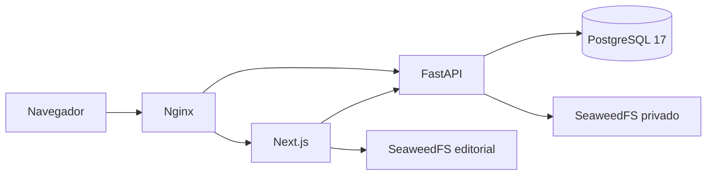

# Arquitetura do laboratório

O gateway Nginx é o único serviço com porta no host (`127.0.0.1:8081`). Ele encaminha `/api/v1` para FastAPI e o restante para Next.js. Server Components usam `API_INTERNAL_URL` para leitura interna e o navegador usa a mesma origem.

`api-migrate` aplica Alembic antes da API. O runtime `smart_api` não recebe a senha de `smart_migrator`. O schema é `smart`, o banco é `smart_construction`, e as variáveis usam `SMART_API_`. Cookie administrativo `smart_admin_session`, CSRF/Origin e controle de versão permanecem ativos. O modo local permite HTTP; uma implantação pública exige HTTPS, origem exata e `SMART_API_ENVIRONMENT=production` para cookie Secure.

O bucket editorial `smart-assets` recebe imagens locais ilustrativas e permite leitura de objetos por meio de `/assets`; o bucket `smart-cadastros-private` exige credenciais. Arquivos de cadastro só são transmitidos publicamente enquanto vinculados a um profissional publicado. Empresas, contatos e documentos não entram na projeção pública. Não há volume ou segredo da SOS Construir nesta cópia.

O catálogo de 93 soluções e 186 produtos continua em fixtures, com preços de referência didática. Cadastros, profissões, contas, histórico e vínculos de imagens são persistidos no PostgreSQL. Não há carga de pessoas ou contas automática. O administrador e a carga de 25 profissões são passos manuais.

O [escopo](escopo.md#31-conexões-em-operação) inclui o mapa completo com portas e volumes, seguido pelas conexões de preparação e ferramentas. As versões vetoriais estão em [operação](diagrams/runtime-connections.svg) e [preparação](diagrams/preparation-connections.svg), acompanhadas das fontes Mermaid no mesmo diretório. As setas representam o iniciador de cada comunicação; respostas retornam pelo caminho correspondente.

## Fronteira da atividade

O Compose local usa uma rede Docker e três volumes exclusivos do projeto. O requisito de duas VMs não está implementado pelo Compose: os alunos precisam separar o banco, restringir a porta à origem privada da API e definir onde armazenar as imagens.

A esteira de CI verifica o código, constrói os containers e executa testes no runner descartável. Ela não tem credenciais de nuvem e não publica. Os pipelines de provisionamento, atualização, backup/restauração e encerramento compõem a entrega dos alunos.
