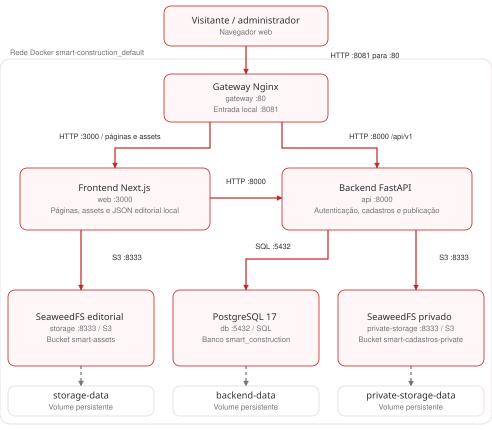
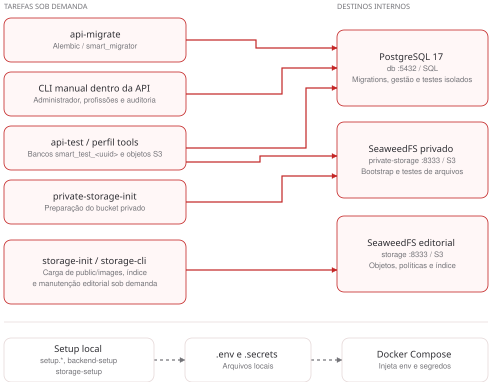

# Escopo — Smart Construction

**Um projeto da Bubikas Holdings** · Laboratório de Engenharia de Software

## 1. Contexto

A **Bubikas Holdings** é uma holding de produtos digitais que ficou conhecida pelo sucesso do **Organizadin**. Com essa experiência, a empresa pretende ampliar seu portfólio e emplacar seu próximo projeto: o **Smart Construction**.

O Smart Construction é uma iniciativa da Bubikas Holdings voltada ao setor da construção civil. A plataforma reúne serviços, materiais e profissionais em uma experiência digital, com catálogo público, cadastros de profissionais e empresas e um painel para análise administrativa. A intenção é transformar essa nova aposta da holding em um produto disponível e operável na nuvem.

A equipe de desenvolvimento da Bubikas Holdings já entregou o código da aplicação, sua configuração local com containers e o fluxo de CI/CD para validação. Para avançar, a holding precisa de um especialista em infraestrutura que planeje a implantação, coloque o Smart Construction em operação e entregue pipelines e procedimentos para sua continuidade. Essa é a contratação simulada neste exercício.

## 2. Objetivo da contratação

Publicar o Smart Construction da Bubikas Holdings em um endereço HTTPS, com persistência dos cadastros e imagens, acesso administrativo protegido e infraestrutura administrável por pipelines. O exercício utiliza exclusivamente pessoas, empresas, documentos e imagens sintéticos; não há contratação ou pagamentos reais.

## 3. Código recebido

- Frontend Next.js com busca, catálogo de 93 soluções e 186 materiais, páginas públicas e formulários.
- API FastAPI com autenticação administrativa, profissões, cadastros, análise, auditoria e publicação de profissionais aprovados.
- PostgreSQL 17 e migrações Alembic; empresas e contatos pessoais restritos à administração.
- SeaweedFS com armazenamento editorial separado dos arquivos privados dos cadastros.
- Dockerfiles, Compose local, configuração Nginx e testes de aplicação/integração.
- CI para validação e construção no runner; credenciais, contas e infraestrutura de nuvem não são fornecidas.

### 3.1. Conexões em operação

O diagrama mostra os serviços do Compose local com suas portas padrão. Setas vermelhas indicam quem inicia a requisição; respostas retornam pelo mesmo caminho. Setas cinzas tracejadas representam gravação em volume local.

**Roteamento:** `/api/v1` vai do Nginx à API. `/assets` passa pelo Next.js até o SeaweedFS editorial. O servidor Next.js também consulta a API para gerar páginas e obter a configuração dos cadastros.

**Acesso e dados:** o gateway é a única porta exposta no host. A API controla os arquivos dos cadastros e a publicação de profissionais; os três volumes recebem o prefixo `smart-construction_`. O catálogo editorial permanece em arquivos JSON locais do frontend.

### 3.2. Preparação e ferramentas

As conexões abaixo são usadas na inicialização ou por comandos manuais. Setas vermelhas representam SQL ou S3; setas cinzas tracejadas representam arquivos de configuração locais.

- Os jobs de migração e preparação terminam antes dos serviços dependentes. Não representam chamadas contínuas da API.
- `storage-init` lê `public/images`; `storage-cli` usa `./backups/storage` nas operações manuais. O setup lê `.env.example` e prepara `.env` e `.secrets/`.
- `api-test` usa bancos `smart_test_<uuid>` e objetos S3 de teste. O CI executa um ambiente descartável, sem conexão com esta instalação ou implantação automática na nuvem.

Os diagramas descrevem o sistema local recebido. A distribuição em VMs, a rede privada e os controles de acesso da nuvem compõem a proposta de infraestrutura a ser entregue.

## 4. Requisitos da infraestrutura

1. Escolher o provedor de nuvem e justificar a escolha segundo os requisitos, custos, facilidade de operação e limitações.
2. Usar no mínimo duas máquinas virtuais. O PostgreSQL deverá estar em uma VM exclusiva, separado dos componentes da aplicação.
3. Conectar API e banco por rede privada. A porta do PostgreSQL não poderá ficar disponível na internet; liberar somente a origem necessária da API.
4. Definir e justificar a distribuição de Next.js, API, Nginx e armazenamentos. Os buckets privados não terão acesso público direto.
5. Configurar HTTPS, origem permitida, cookies seguros, acesso administrativo restrito e segredos fora do repositório/logs.
6. Garantir persistência dos dados e imagens durante reinícios e atualizações, com plano de backup e restauração testado.
7. Criar pipelines para provisionar, configurar, atualizar e encerrar a infraestrutura, integrados ao fluxo existente de CI/CD. Documentar etapas manuais justificadas, aprovações operacionais e tratamento de segredos.

## 5. Proposta técnica e custos

Apresentar diagrama, dimensionamento inicial, serviços escolhidos, estimativa mensal discriminada, premissas de uso, armazenamento, tráfego e alternativas. A Bubikas Holdings pede a justificativa do valor; não é necessária uma etapa de aprovação financeira para seguir o exercício. Contratação de recursos reais e limites de gasto seguem as orientações do professor e as permissões da conta utilizada.

## 6. Marcos de entrega

1. Diagnóstico do repositório, arquitetura proposta e estimativa de custos.
2. Provisionamento de VMs, rede privada, controles de acesso e persistência.
3. Implantação do PostgreSQL isolado, aplicação e armazenamentos.
4. Publicação HTTPS e integração frontend/API, com versões dos aceites correspondentes.
5. Pipelines de infraestrutura, atualização da aplicação e evidências de execução.
6. Testes funcionais, persistência, backup/restauração e passagem de conhecimento.
7. Demonstração do encerramento dos recursos e relatório do que permanece gerando cobrança.

## 7. Critérios de aceite

- Página inicial, busca e catálogo disponíveis em HTTPS, sem assets remotos obrigatórios.
- Cadastro sintético de profissional e empresa persistido, com imagens opcionais.
- Login administrativo, consulta, edição, histórico e aprovação funcionando.
- Profissional aprovado visível publicamente; pendentes/reprovados, empresas, documentos e contatos privados inacessíveis sem autenticação.
- Banco em VM exclusiva, sem porta pública, com evidência dos controles de rede.
- Dados e imagens preservados após reinício e atualização.
- Pipelines reproduzíveis com segredos protegidos e evidências de uma alteração.
- Backup restaurado em ambiente isolado, sem sobrescrever o ambiente principal.
- Documentação com arquitetura, custos, acessos, logs, atualização, recuperação e encerramento.

## 8. Limites

Não é exigido desenvolver novos módulos de negócio, meios de pagamento, login de clientes ou integrações com WhatsApp. Os textos legais e dados são simulações didáticas. A solução deve preservar os controles da aplicação e explicar suas limitações; uma página acessível isoladamente não comprova toda a entrega.
